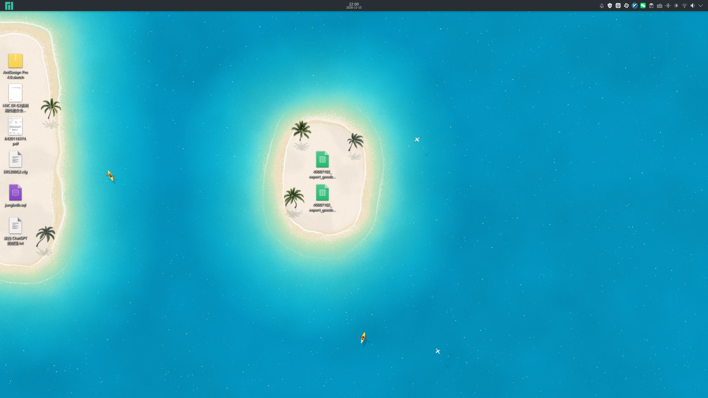
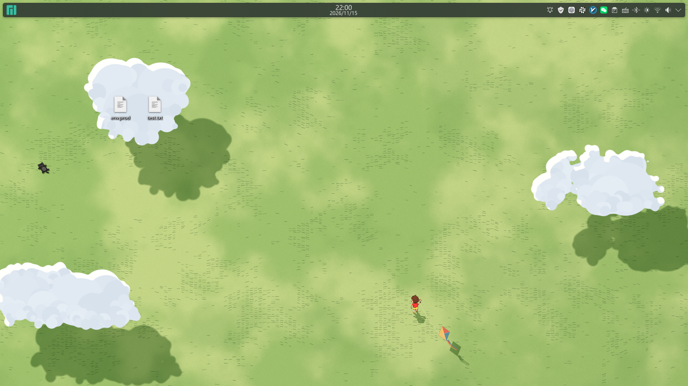
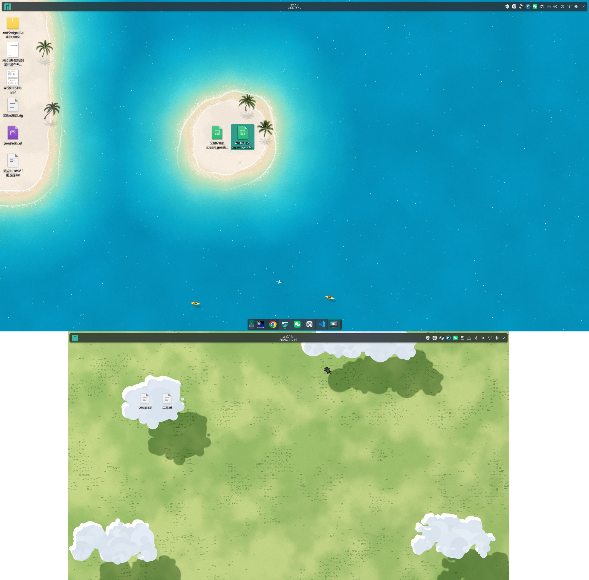
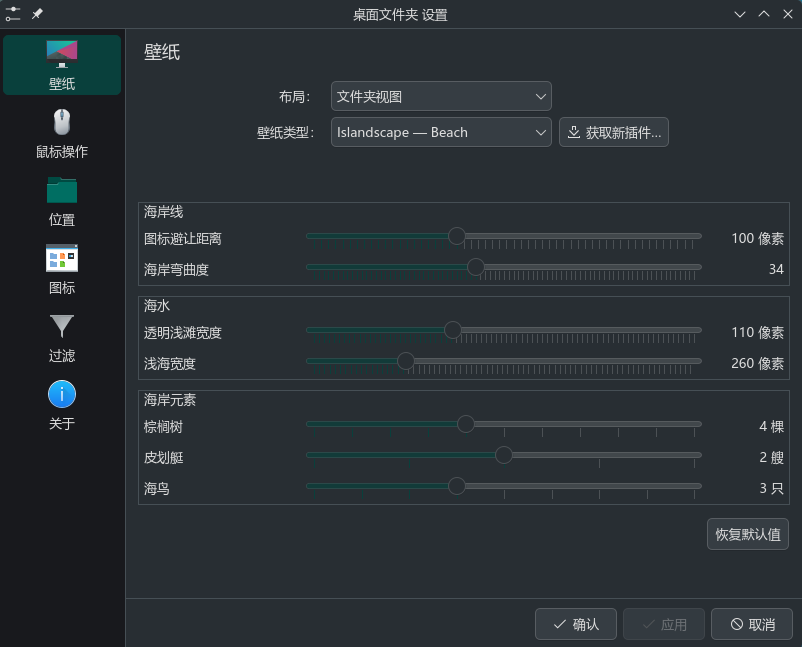
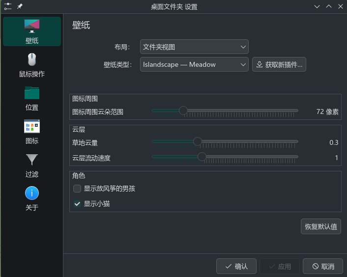

# Islandscape for KDE Plasma

[简体中文](#简体中文) | [English](#english)

## 简体中文

起因是我平时用 Arch Linux 和 KDE Plasma。[Deskland](https://deskland.app/) 作者目前提供 Windows 版，也在开发 macOS 版，暂时没有 Linux 版。看到作者开放了源码后，我就把其中开放的 Beach 和 Meadow 主题移植到了 Plasma，做成自己能安装使用的动态壁纸。

感谢 [Deskland Preview 作者](https://github.com/BLEZZ0102/Deskland) 开源这个项目和两个非常漂亮的主题，让这次移植成为可能。

壁纸场景仍由 HTML/WebGL2 绘制，Plasma 端用 QML 插件把它们接入桌面，也负责读取图标位置、适配显示缩放和处理窗口遮挡。动画帧率上限为 30 FPS。Plasma 可以分别管理各台显示器的刷新率；2K 和 4K 分辨率已完成验证。

目前我只在自己的 Arch Linux + KDE Plasma 环境中测试过，其他发行版和桌面环境还没有验证。

### 截图

| Beach 桌面 | Meadow 桌面 |
|:---:|:---:|
|  |  |

**多屏桌面**



| Beach 设置 | Meadow 设置 |
|:---:|:---:|
|  |  |

### 内含壁纸

- **Islandscape — Beach**：海浪、海岸线、皮划艇、海鸟和棕榈树。
- **Islandscape — Meadow**：草地、飘动的云、阴影、放风筝的男孩和一只猫。

两个主题会作为独立选项显示在 Plasma 壁纸选择器中。

### 参数配置

每个主题在 `theme.json` 中声明自己的参数。例如：

```json
{
  "id": "beach",
  "params": {
    "library": "coastal",
    "groups": [{"name": {"en": "Shoreline", "zh": "海岸线"}, "keys": ["sigma", "warp"]}],
    "labels": {"sigma": {"label": {"en": "Distance from icons", "zh": "图标避让距离"}, "unit": {"en": "px", "zh": "像素"}}},
    "defaults": {"sigma": 100}
  }
}
```

- `src/linux/param-library.json` 保存共享的数值规则。`coastal` 库包含海岸主题共享的参数
  （`sigma`、`warp`、`shoal`、`shallow`、`palms`、`kayaks`、`birds`）；`meadow` 库保存草地主题的参数规则。
- 标签、提示、单位、分组和默认值由主题声明，因此可以独立翻译和调整。
- 参数界面根据系统首选语言显示中文或英文；其他语言默认显示英文。
- 一份参数定义会生成配置界面（`contents/ui/config.qml`）、KConfig schema
  （`contents/config/main.xml`）、壁纸宿主使用的参数表（`contents/ui/main.qml`）以及传给主题页面的约束表，避免重复维护范围、步长和默认值。

参数按主题保存在 Plasma 的壁纸配置中，切换主题不会混用设置。配置对话框使用 Plasma 的标准界面，可从壁纸预览旁打开。

### 宿主与主题页面通信

壁纸宿主与主题页面通过 `window.postMessage` 通信：

| 消息 | 方向 | 内容 |
|---|---|---|
| `params` | 宿主 → 页面 | 每个参数的范围、步长和默认值 |
| `settings` | 宿主 → 页面 | 当前参数值 |
| `reset` | 宿主 → 页面 | 要恢复的参数值 |
| `icons` | 宿主 → 页面 | 当前屏幕上桌面图标的物理像素矩形 |
| `pause` | 宿主 → 页面 | 最大化或全屏窗口覆盖当前屏幕时为 true |
| `ready` | 页面 → 宿主 | 页面已安装消息监听器 |

页面通过 `window.devicePixelRatio` 将图标的物理像素坐标换算为页面坐标。宿主也从页面同步缩放比例，避免 Plasma 缩放变化导致壁纸与图标位置错位。

### 在基于 Arch 的 Plasma 6 上安装

运行环境需要 KDE Plasma 6、Qt 6 版 QtWebEngine、`kpackagetool6`、Python 3 和正在运行的 Plasma 用户会话。脚本会安装到当前用户的 KPackage 目录，请勿使用 `sudo`。

```sh
./install.sh
```

安装脚本会构建并安装两个壁纸包，同时记录每个屏幕当前使用的壁纸插件 ID。然后打开 **系统设置 → 壁纸**（或桌面壁纸选择器）选择主题。如果主题尚未显示，可以注销并重新登录，或重启 Plasma Shell：

```sh
systemctl --user restart plasma-plasmashell.service
```

如果手动安装软件包，请先运行 `scripts/backup-wallpapers.sh`，这样卸载时才能恢复每个屏幕之前使用的壁纸插件。

### 卸载与恢复

如果安装时已保存壁纸状态，运行：

```sh
./uninstall.sh
```

卸载脚本会将仍在使用 Islandscape 的屏幕切回保存的壁纸插件，然后删除 Islandscape 软件包。Plasma 会保留各壁纸插件自己的设置；切回原插件后，其图像和壁纸设置也会恢复。

如果安装后手动更换过原壁纸，请先在 Plasma 壁纸选择器中选好要恢复的壁纸再卸载。卸载脚本只会恢复仍在使用 Islandscape 的屏幕。如果没有备份，脚本会拒绝删除仍处于启用状态的软件包，以免桌面壁纸失效；请先切换到其他壁纸，或在选择 Islandscape 前运行备份脚本。

### 仅构建软件包

```sh
./scripts/build-packages.sh
```

生成的软件包位于 `build/packages/`，无需编译 C++。

### 源码目录

```text
upstream/Deskland/       未修改的上游文件
src/linux/               Plasma QML 宿主、图标桥接、缩放和暂停处理
src/linux/param-library.json  共享参数规则
src/themes/               适配 Linux 的 Beach 和 Meadow 主题页面
packaging/                两个壁纸条目的 Plasma KPackage 元数据
scripts/                  构建、安装、备份、恢复和卸载脚本
```

上游版本、许可证和 Linux 适配内容详见 [`UPSTREAM.md`](UPSTREAM.md)。上游许可证和商标说明随源码保存在 `upstream/Deskland/` 中；本项目采用 GPL-3.0-only 发布。

## English

I use Arch Linux with KDE Plasma as my daily desktop. [Deskland](https://deskland.app/)
is currently available for Windows, and its author is also working on a macOS
version. There is no Linux version yet. When the author made the source
available, I ported the Beach and Meadow themes to Plasma so I could use them
on my own desktop.

Thanks to the [Deskland Preview author](https://github.com/BLEZZ0102/Deskland)
for open-sourcing the project and its two beautiful themes, making this port
possible.

The scenes are still rendered with HTML/WebGL2. A QML wallpaper plugin connects
them to Plasma and handles desktop icon positions, display scaling, and covered
screens. Animation is capped at 30 FPS. Plasma lets me set the refresh rate for
each display separately. The wallpaper has been verified at 2K and 4K
resolutions.

So far, I have only tested it on my own Arch Linux + KDE Plasma setup. Other
distributions and desktop environments have not been verified.

### Screenshots

See the screenshot gallery in the Simplified Chinese section above for the
Beach and Meadow desktops, a multi-monitor setup, and both wallpaper settings
panels.

### Included wallpapers

- **Islandscape — Beach**: waves, shoreline, kayaks, birds and palms.
- **Islandscape — Meadow**: grass, drifting clouds, shadows, a kite-flying boy
  and a cat.

They appear as separate entries in Plasma's wallpaper chooser.

### Parameters

Each theme describes its parameters in `theme.json`. For example:

```json
{
  "id": "beach",
  "params": {
    "library": "coastal",
    "groups": [{"name": {"en": "Shoreline", "zh": "海岸线"}, "keys": ["sigma", "warp"]}],
    "labels": {"sigma": {"label": {"en": "Distance from icons", "zh": "图标避让距离"}, "unit": {"en": "px", "zh": "像素"}}},
    "defaults": {"sigma": 100}
  }
}
```

- `src/linux/param-library.json` holds shared numeric rules. The `coastal`
  library covers parameters shared by coastal themes (`sigma`, `warp`, `shoal`,
  `shallow`, `palms`, `kayaks`, `birds`); the `meadow` library holds the meadow
  parameter rules.
- Labels, hints, units, groups and defaults belong to each theme, so they can
  be translated and adjusted independently.
- The parameter UI follows the system's preferred language and displays
  English or Chinese; other languages fall back to English.
- One parameter definition produces the configuration UI
  (`contents/ui/config.qml`), the KConfig schema (`contents/config/main.xml`),
  the parameter table compiled into the wallpaper host
  (`contents/ui/main.qml`) and the constraint table sent to the theme page.
  This avoids duplicating ranges, steps and defaults.

Settings are stored per theme in Plasma's wallpaper configuration, so
switching themes never mixes their settings. The configuration dialog uses
Plasma's standard UI and opens next to the wallpaper preview.

### Host and theme protocol

The wallpaper host and theme page communicate through `window.postMessage`:

| Message | Direction | Payload |
|---|---|---|
| `params` | host → page | range, step and default of every parameter |
| `settings` | host → page | the current values |
| `reset` | host → page | the values to restore |
| `icons` | host → page | the icon rectangles for this output, in physical pixels |
| `pause` | host → page | true while a maximized or fullscreen window covers the output |
| `ready` | page → host | the page installed its listener |

The page converts physical pixel coordinates for icons using
`window.devicePixelRatio`. The host also reads the scale from the page so a
Plasma scale change cannot misalign the wallpaper and icons.

### Install on Arch-based Plasma 6

Runtime requirements are KDE Plasma 6, QtWebEngine for Qt 6, `kpackagetool6`,
Python 3, and a running Plasma user session. The scripts install into the
current user's KPackage directory; do not run them with `sudo`.

```sh
./install.sh
```

The installer builds and installs both wallpaper packages and records the
current wallpaper plugin ID for each screen. Open **System Settings →
Wallpaper** (or the desktop wallpaper picker) and choose a theme. If the
entries do not appear yet, log out and back in, or restart the Plasma shell:

```sh
systemctl --user restart plasma-plasmashell.service
```

If you install packages manually, run `scripts/backup-wallpapers.sh` first so
uninstall can restore the previous wallpaper plugin on each display.

### Uninstall and restore

If `install.sh` recorded the wallpaper state, run:

```sh
./uninstall.sh
```

The uninstaller switches displays that still use Islandscape back to their
saved wallpaper plugin, then removes the Islandscape packages. Plasma retains
each wallpaper plugin's settings, so switching back restores its image and
wallpaper settings.

If you changed the original wallpaper after installation, choose the desired
wallpaper in Plasma's wallpaper picker before uninstalling. The uninstaller
only restores screens that still use Islandscape. Without a backup, it refuses
to remove a package that is still active, avoiding a broken wallpaper. Switch
to another wallpaper first, or run the backup helper before selecting
Islandscape.

### Build packages without installing

```sh
./scripts/build-packages.sh
```

The generated wallpaper packages are written to `build/packages/`. No C++
compilation is needed.

### Source layout

```text
upstream/Deskland/       Unmodified upstream files
src/linux/               Plasma QML host, icon bridge, scale and pause handling
src/linux/param-library.json  Shared parameter rules
src/themes/              Linux-adapted Beach and Meadow theme pages
packaging/               Plasma KPackage metadata for both wallpaper entries
scripts/                 Build, install, backup, restore and uninstall helpers
```

See [`UPSTREAM.md`](UPSTREAM.md) for the upstream revision, licenses and the
Linux adaptation list. The upstream license and trademark notice are kept in
`upstream/Deskland/`; this project is distributed under GPL-3.0-only.
